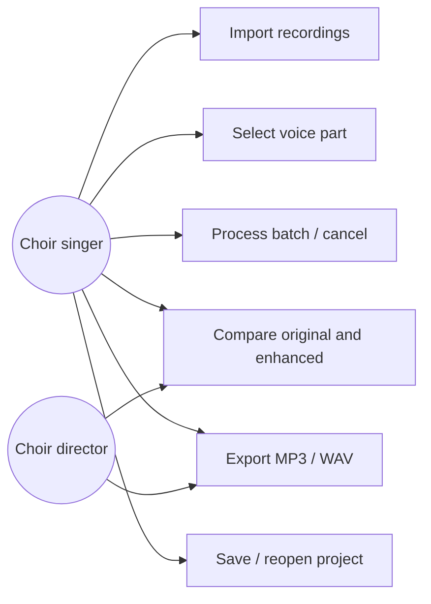
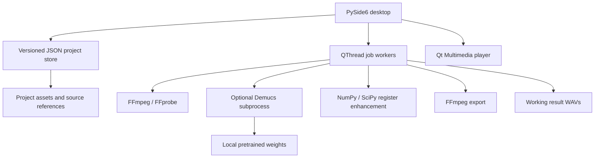
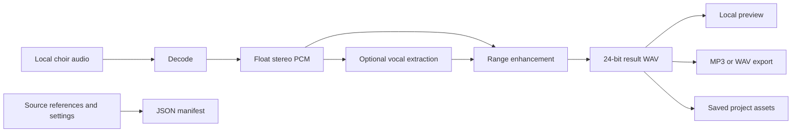
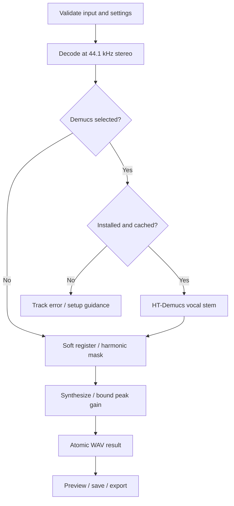
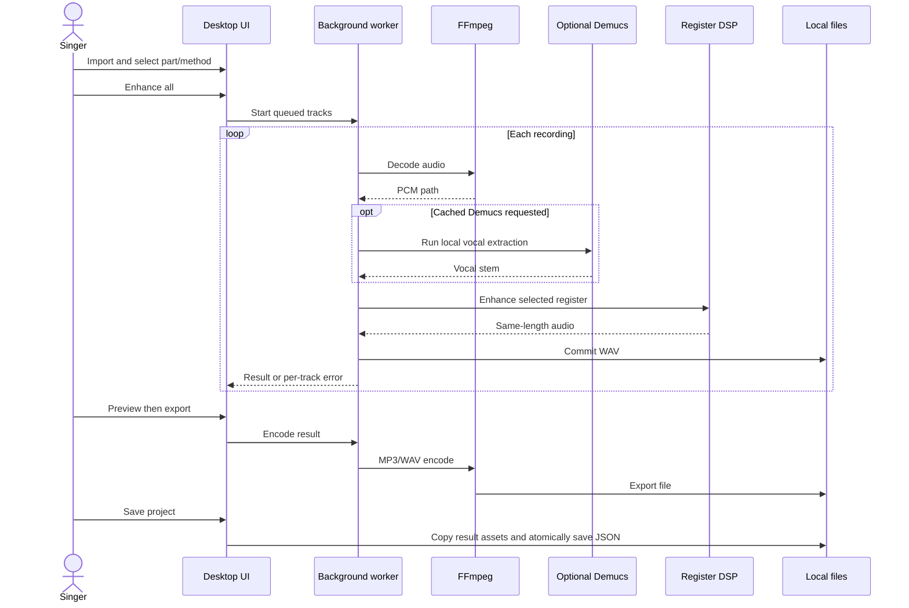

# Product and architecture decision

## Vision, scope and evidence

Help amateur choir singers hear and learn their line locally. Prioritize tenor/bass recordings from church rehearsals; preserve rhythm/pitch; provide batch import, preview, project save/reopen and MP3/WAV export. No uploads or accounts. Python 3.12+, Windows/macOS, CPU baseline and optional NVIDIA CUDA constrain the implementation.

The supplied PRD combines an application brief with a research brief. This implementation delivers a usable desktop foundation and a conservative register-enhancement pipeline. **It does not fulfill the core promise of isolated simultaneous SATB stems.** That capability remains a research and validation gate. A recording with one singer per section, a close microphone and strong stereo placement may yield a helpful emphasis; a mono blended choir in reverberation may not.

The comparisons below are engineering assessments of established model families and published tasks, not a fresh benchmark or exhaustive survey of every release as of November 2026. No choir corpus or target-user listening study was supplied. Do not interpret planning estimates as measured performance.

Proposed release acceptance gates, to agree with choir directors before commercial use:

- At least 30 legally usable representative choir recordings across phones, WhatsApp compression, room reverberation and piano, with consent and voice-part references where possible.
- Blind comparison with the original and simple EQ baseline. At least 80% of test users rate tenor/bass practice usefulness 4/5 or better on at least 70% of the corpus. These are proposed targets, not achieved results.
- With reference stems, measure SI-SDR improvement and inspect target f0/timing preservation. Do not use a single spectral score as a substitute for listening.
- No missing files, partial exports or source overwrites in acceptance tests; cancellation leaves the UI usable and keeps completed outputs.
- Benchmark a 5-minute recording on a named CPU/GPU before defining latency promises. Full offline test with networking disabled after setup.

## One recommended architecture today

**PySide6 + Python service modules + FFmpeg + NumPy/SciPy/SoundFile, with optional HT-Demucs vocal extraction.** Ship the baseline as a rehearsal enhancer while evaluating SATB-specific models separately. Do not market generic music source separation as choir-part isolation.

| Layer | Choice | Reason |
|---|---|---|
| Language | Python 3.12+ | Direct DSP and ML integration |
| Desktop | PySide6 / Qt Widgets | Native desktop lifecycle, playback, background jobs; LGPL option subject to compliance |
| Media I/O | FFmpeg and FFprobe | Common phone/messaging codecs; deterministic conversion/export |
| DSP | NumPy + SciPy STFT | Explainable fallback; pitch/time unchanged |
| PCM files | SoundFile | Float decoding, 24-bit WAV output |
| Optional inference | PyTorch + matching TorchAudio | Established Demucs runtime; CPU/CUDA |
| Pretrained model | HT-Demucs `htdemucs` | Practical vocals/accompaniment preprocessing, no training |
| Persistence | Versioned JSON `.choir` + `.assets` | Inspectable, atomic manifest save, relative references |
| Distribution | PyInstaller per platform | DSP prototype recipe; AI worker packaging remains a milestone |

PyQt6 offers a similar Qt API but GPL/commercial licensing is less convenient for some distribution plans. PySide6 is the recommendation. Electron + Python adds Chromium footprint, IPC and two toolchains. Tauri + Python reduces frontend footprint but adds Rust and sidecar packaging, permissions and IPC work. Neither is justified for this local V1 workflow.

Modules: `app.py` owns Qt presentation and QThread workers; `project.py` owns schema/persistence; `audio.py` owns decoding, DSP, subprocess lifecycle and exports; `__main__.py` owns startup and explicit online model preparation. Processing modules have no Qt dependency. New backends should conform to the same process/progress/cancellation contract; a formal backend registry is future work, not implemented.

## Pretrained source-separation model assessment

| Candidate | Suitable task / expected limit | V1 decision |
|---|---|---|
| HT-Demucs / Demucs | Music stems including vocals; choir sections remain mixed in vocal stem | Recommended optional preprocessor |
| MDX-Net | Music vocal/instrumental extraction; checkpoint-specific quality and licensing | Compare later on choir/piano corpus |
| Ultimate Vocal Remover | Application/ecosystem integrating several model families, not a single SATB model | Benchmark selected licensed models; do not embed its whole UI |
| Open-Unmix | Established music-stem baseline | Useful benchmark; no SATB semantics |
| Spleeter | Fast established music-stem baseline, TensorFlow dependency/version burden | Not preferred for Python 3.12 V1 |
| Band Split RNN / BS-RoFormer families | Strong music separation research; open weights differ by training/task/license | Candidate for vocal preprocessing after license/runtime review |
| Conv-TasNet | Separation architecture; speech-trained checkpoints do not become choir separators | No direct generic pretrained V1 solution |
| Dedicated SATB separator | Potential to learn section-specific harmonic structure | Adopt only if open weights, compatible inference, rights and choir benchmarks are demonstrated |

Generic music models usually separate source classes such as drums, bass instrument and vocals. Their “bass” stem is **not the choir bass section**. Register classification of a polyphonic vocal mixture does not create missing independent sources.

Audio-library choice: Librosa is useful for analysis/f0 experiments, but not necessary for the basic STFT path; TorchAudio serves optional ML dependencies; FFmpeg handles codecs; SciPy supplies analysis/synthesis; SoundFile handles WAV; Pydub would add an unnecessary wrapper for the implemented path.

Framework choice: PyTorch is sufficient. TensorFlow is chiefly relevant if adopting a compatible Spleeter or custom model. SpeechBrain, Asteroid and NVIDIA NeMo provide speech separation/embedding research infrastructure but their ordinary pretrained speech models are not validated SATB solutions. Pyannote diarization targets who speaks when; simultaneous chorus voices violate its usual assumptions. Whisper transcribes speech and does not separate singing sections or extract rehearsal stems. Avoid adding these frameworks without a task-specific experiment.

## Approaches A–E

| Approach | Accuracy / feasibility | Cost / complexity | Decision |
|---|---|---|---|
| A. Frequency filtering | Can emphasize a register; harmonic and fundamental overlap prevents isolation | Low DSP cost and straightforward offline deployment | Implement as explicitly labeled enhancement baseline |
| B. Vocal extraction + register analysis | Reduces piano/drums; register mask still admits simultaneous singers, harmonics and residual piano | Moderate to high inference cost, modest integration | Best feasible pretraining-only staged prototype |
| C. Embeddings + clustering | Works better on sequential speakers than blended simultaneous singing; many singers per part and common lyrics defeat identity assumptions | High experimentation cost; requires multi-source separation before reliable identity analysis | Reject as primary V1 method |
| D. Learned SATB separation | Highest relevant potential when trained on appropriate choir mixtures; no validated drop-in weights selected here | High validation/integration complexity; may require score guidance | Research gate before claiming isolated parts |
| E. Custom choir models | Dataset, rights, mixed/unmixed references, section labels and generalization are substantial work | Training and maintenance beyond V1 | Future roadmap only; no V1 training requirement |

## Processing and inference

1. Import local audio paths; create stable track IDs and selected part/method.
2. Check FFmpeg, input existence, supported settings and duration (30-minute limit).
3. Decode to 44.1 kHz stereo float PCM using FFmpeg in a unique temporary directory. The UI does not block.
4. Optional HT-Demucs: require installed dependencies and cached `955717e8` HT-Demucs checkpoint, run a dedicated subprocess using `apply_model` with shifts disabled and the vocal source selected, CPU or CUDA. This extracts the vocal stem, not a choir section. GPU failures appear per track; there is no silent automatic CPU retry.
5. Apply a soft STFT register mask with harmonic allowance. Selected ranges are approximate musical fundamentals: Bass C2–C4, Tenor C3–C5, Alto F3–F5, Soprano C4–C6. Actual ranges vary and overlap. Spectral analysis uses 4096-sample windows and 1024-sample hops with ~20-second blocks and aligned overlap context.
6. Synthesize at unchanged sample count and sample rate. Limit gain to 2× and peaks to 0.95; avoid a claim of perceptual loudness normalization.
7. Atomically move the completed 24-bit WAV into application data. Keep completed results on cancellation.
8. Preview source/result through Qt Multimedia. Speed is a playback convenience; pitch preservation under playback-rate change is backend dependent. Export retains original sample timing.
9. Export MP3 at 192 kbps or 24-bit WAV through a temporary file and atomic replacement. Batch filenames include track IDs. UI prevents exports over imported sources.
10. Save versioned JSON plus generated assets; reopen/re-export without recomputation. Source files remain external. Unknown versions and invalid paths/settings are rejected or flagged.

Inference is sequential to avoid CPU/GPU memory contention. Subprocess output goes to a temporary log rather than an unconsumed pipe. Cancellation terminates the FFmpeg/Demucs process; DSP checks cancellation between approximately 20-second spectral blocks. A worker does not mutate Qt widgets directly. Errors are reported per track; following tracks continue. Crash resume, disk-space preflight, persistent logs and model-integrity verification beyond the Demucs loader are future improvements.

## Resource and performance expectations

Planning estimates only: DSP should be faster than real time on a modern laptop, but depends on file length, codec and storage. HT-Demucs on CPU may take several times recording duration; CUDA may be near or faster than real time on suitable GPUs, but **no specific real-time factor is promised without a benchmark**. Start with 16 GB RAM for the optional AI path, roughly 4–8 GB VRAM for GPU experiments, and several GB free disk. Shorter recordings may work with less RAM; model versions and segment settings affect memory. Reserve temporary space for decoded PCM, the extracted Demucs vocal stem and result files. A five-minute stereo float32 PCM file at 44.1 kHz alone is about 106 MB; model working memory dominates AI usage. Model/dependency downloads can be hundreds of MB to multiple GB. The DSP spectral blocks are bounded, but whole-track input/output buffers remain resident.

No evidence supports a numeric SATB “accuracy” estimate here. Piano reduction can be useful; low voices may sound clearer, duller, incomplete or unchanged depending on the recording. Strong artifacts or a wrong perceptual line require rejecting the output for rehearsal.

## Deployment

Install locally in a virtual environment, prepare optional weights explicitly while online, then run offline. No runtime server, accounts or telemetry. Model cache defaults to Torch's standard cache, respecting `TORCH_HOME`/`XDG_CACHE_HOME`. Dependency/weight transfer must preserve licenses and target platform compatibility. Model existence checks avoid routine weight fetches; validate network isolation on target release builds.

Windows/macOS are the product targets, but development validation here runs on Linux. Build and test each target on its native OS; macOS signing/notarization and Windows signing/installer remain release work. FFmpeg must be installed or appropriately bundled. PyInstaller source recipe supports DSP only today; an AI distribution requires a real inference sidecar or refactored in-process backend and separate packaged testing. Maintain CPU distribution first; CUDA support must match drivers and the PyTorch build. There is no macOS CUDA path.

## Risks and mitigations

| Risk | Consequence | Mitigation |
|---|---|---|
| SATB ranges/harmonics overlap | Another voice survives the same filter | Label enhancement, compare original, validate dedicated model |
| Polyphonic same-lyric singing | f0 and identity ambiguity | Never use speech clustering as proof of section separation |
| Similar timbres, vibrato, many singers and choir blending | Weak source identity cues | Evaluate section-level datasets and score-assisted methods later |
| Reverberation/distant phone microphone | Temporal smearing and separation artifacts | Keep original; target corpus includes church acoustics |
| Piano overlaps tenor/bass harmonics | Wrong notes survive | Optional vocal extraction; reference listening with a director |
| WhatsApp compression/clipping/noise | Missing detail cannot be reconstructed reliably | Avoid pitch/quality promises, test real exports |
| CPU cost and GPU memory | Long waits, failed jobs | Sequential jobs, visible stage/progress, cancel, short test files |
| Model/dependency/platform drift | Installation/inference failures | Separate optional dependencies; native OS CI/release matrix |
| Low quality results mistaken for isolation | Singers learn wrong line | Clear labels and listening acceptance gate before launch |
| Paths/assets moved or working cache removed | Missing original/result | Relative manifest paths, saved result assets, missing-file flags |

## Required diagrams

### Use cases

### Components

### Data flow

### Processing pipeline

### Sequence

## Development estimate and conclusion

A single experienced desktop/audio engineer can usually build the desktop foundation and baseline in 2–4 weeks, integrate/benchmark a pretrained vocal backend in another 1–2 weeks, and spend 2–4 additional weeks on listening evaluation, native packaging, installer/signing and robustness. These are rough sequential estimates, not delivery commitments. The research gate for reliable SATB separation has open-ended complexity and cannot be scheduled as ordinary UI work. This repository is an initial implementation, not evidence those production milestones are complete.

**Can open-source technology isolate tenor/bass from typical church recordings well enough?** It can realistically produce useful *rehearsal enhancement on some recordings*, especially after accompaniment suppression. Established generic open-source music models do not justify promising reliably isolated tenor/bass from arbitrary blended choirs. Probability of shipping a functional local desktop enhancer is high; probability of meeting the supplied isolation promise across typical uncontrolled recordings is unknown until choir-specific models and listening tests establish it. Assigning a percentage without data would be misleading. Recommend shipping only with transparent enhancement wording and passing the listening gate before making isolation claims. No custom training is required for the prototype or this V1 evaluation; custom choir modeling remains a later option.

## Reference starting points

These links identify upstream projects/tasks; specific model licenses and current compatibility must be reviewed when selecting a release.

- Demucs: https://github.com/facebookresearch/demucs
- UVR: https://github.com/Anjok07/ultimatevocalremovergui
- Open-Unmix: https://github.com/sigsep/open-unmix-pytorch
- Spleeter: https://github.com/deezer/spleeter
- Asteroid: https://github.com/asteroid-team/asteroid
- SpeechBrain: https://github.com/speechbrain/speechbrain
- Pyannote: https://github.com/pyannote/pyannote-audio
- NeMo: https://github.com/NVIDIA/NeMo
- Qt for Python: https://doc.qt.io/qtforpython-6/
- FFmpeg: https://ffmpeg.org/documentation.html
